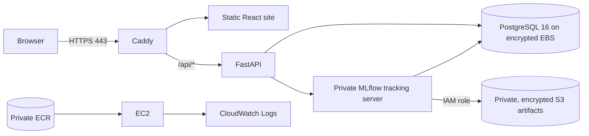

# TeleGuard AI AWS Deployment Guide

> The commands and cost examples below describe the prepared 2026-11-19 deployment baseline and its limitations. Use the [incremental readiness and verification plan](#incremental-aws-readiness-and-verification-tg-13) for new release gates. Historical rates are indicative. Provisioning and deployment require explicit owner authorization.

## Status and architecture

This repository contains a prepared production deployment, not a live AWS deployment. AWS account credentials, an AWS CLI session, an EC2 instance, an ECR registry and a domain were unavailable in this session. Do not treat the commands below as evidence that resources exist.



The target region is `ap-south-1` (Mumbai). The original 2026-11-19 demonstration baseline proposed one x86-64 `t3.medium` (2 vCPU, 4 GiB RAM) with encrypted 40 GiB gp3 EBS. That baseline is superseded by the local sizing evidence below: the current Terraform default is `t3.large` (2 vCPU, 8 GiB RAM). This remains a single-node educational demonstration, not a highly available service or carrier-traffic deployment. All data remains synthetic.

PostgreSQL and MLflow have no published host ports. Caddy publishes only 80/443; MLflow has no public route. The API and web containers are private on the Compose network. Application images are pulled from ECR; MLflow artifacts use S3 through the EC2 instance profile. PostgreSQL, active model cache and Caddy state use bind-mounted directories under `/opt/teleguard/deploy-state`, which must reside on the encrypted persistent EBS filesystem. Trained model records retain the MLflow run ID so the API can download a trusted joblib artifact through MLflow when the local cache is absent.

## Prerequisites

- An AWS account with billing alerts and a budget you control.
- An IAM deployment operator or GitHub OIDC role with only the actions below.
- An EC2 instance profile with ECR pull, S3 artifact, SSM and CloudWatch Logs permissions.
- A domain and DNS control for automatic HTTPS. Caddy obtains and renews a Let's Encrypt certificate; TCP 80/443 and correct public DNS are required.
- Docker Engine + Compose plugin on EC2, AWS CLI v2, SSM Agent, `curl`, and `jq`.
- AWS CLI configured locally with an authorized profile. Never paste access keys into chat or source.

## Provisioning outline (PowerShell)

Use the AWS Console or IaC after confirming account, budget and domain ownership. These are resource-creating actions and were not run here. Set the correct profile and region first:

```powershell
$env:AWS_PROFILE = 'your-authorized-profile'
$env:AWS_REGION = 'ap-south-1'
aws sts get-caller-identity
aws configure get region
```

Create two private ECR repositories (`teleguard-api`, `teleguard-web`), a uniquely named S3 bucket in `ap-south-1`, and an EC2 instance profile. Enable S3 Block Public Access, bucket versioning, and SSE-S3 or SSE-KMS encryption. Scope the EC2 role to `ecr:GetAuthorizationToken`, pull actions on the two repository ARNs, `s3:PutObject/GetObject/ListBucket` only for the MLflow artifact prefix, CloudWatch log stream creation/write for `/teleguard/production`, and the SSM managed-instance permissions needed for Session Manager and Run Command. Do not attach AdministratorAccess.

Create an MLflow-artifact bucket and a separate PostgreSQL-backup bucket. These PowerShell examples assume unique names and create AES-256-encrypted, versioned buckets with public access blocked, two scan-on-push ECR repositories, and a 14-day CloudWatch log group:

```powershell
$region = 'ap-south-1'
$artifactBucket = '<globally-unique-teleguard-mlflow-bucket>'
$backupBucket = '<globally-unique-teleguard-backup-bucket>'
foreach ($bucket in @($artifactBucket, $backupBucket)) {
  aws s3api create-bucket --bucket $bucket --region $region --create-bucket-configuration LocationConstraint=$region
  aws s3api put-public-access-block --bucket $bucket --region $region --public-access-block-configuration BlockPublicAcls=true,IgnorePublicAcls=true,BlockPublicPolicy=true,RestrictPublicBuckets=true
  aws s3api put-bucket-versioning --bucket $bucket --region $region --versioning-configuration Status=Enabled
  aws s3api put-bucket-encryption --bucket $bucket --region $region --server-side-encryption-configuration '{"Rules":[{"ApplyServerSideEncryptionByDefault":{"SSEAlgorithm":"AES256"}}]}'
}
aws ecr create-repository --repository-name teleguard-api --region $region --image-scanning-configuration scanOnPush=true --encryption-configuration encryptionType=AES256
aws ecr create-repository --repository-name teleguard-web --region $region --image-scanning-configuration scanOnPush=true --encryption-configuration encryptionType=AES256
aws logs create-log-group --log-group-name /teleguard/production --region $region
aws logs put-retention-policy --log-group-name /teleguard/production --retention-in-days 14 --region $region
```

Limit the EC2 role to `s3:ListBucket` on those bucket ARNs and object read/write only under `mlflow/*` or `postgres/*`; deny requests where `aws:SecureTransport` is false. Configure an S3 lifecycle rule for backup retention appropriate to your submission. Do not expire MLflow artifacts still referenced by registry versions or predictions.

Create an EC2 security group with inbound TCP 80/443 from the internet and SSH TCP 22 only from your current public IP (or omit SSH and use SSM Session Manager). Do not open 5432, 5000, 8000 or 5173. Require IMDSv2. Attach an encrypted 40 GiB gp3 volume. For a new blank volume only, identify its NVMe device with `lsblk`; do not format a volume containing data. The sample below is destructive to the selected device and is only for a confirmed blank volume:

```bash
sudo lsblk -f
device=/dev/nvme1n1 # Replace only after verifying the attached blank EBS volume.
sudo mkfs.ext4 "$device"
sudo mkdir -p /opt/teleguard
sudo mount "$device" /opt/teleguard
sudo blkid "$device" # Copy the UUID from this output.
echo 'UUID=REPLACE_WITH_VERIFIED_UUID /opt/teleguard ext4 defaults,nofail 0 2' | sudo tee -a /etc/fstab
```

Use the verified filesystem UUID, then ensure the mount is active before Docker starts. Do not run `mkfs` on a volume containing application data. Before the first Compose deployment, move Docker's data root onto that EBS filesystem:

```bash
# Run only on a fresh instance before any TeleGuard containers or volumes exist.
sudo systemctl stop docker
sudo mkdir -p /opt/teleguard/docker /etc/docker
printf '{"data-root":"/opt/teleguard/docker"}\n' | sudo tee /etc/docker/daemon.json
sudo systemctl start docker
docker info --format '{{.DockerRootDir}}'
```

The last command must show `/opt/teleguard/docker`. Install Docker Engine/Compose, AWS CLI v2 and SSM Agent using the current official distribution instructions for the selected Linux AMI.

Choose Ubuntu LTS or Amazon Linux 2023 x86-64. Start local deployment rehearsals with `t3.large` (2 vCPU, 8 GiB) and encrypted 40 GiB EBS. The 2026-11-28 bounded local replay measured peak container memory of approximately 451 MB API, 545 MB PostgreSQL, 2,552 MB MLflow, and 273 MB worker on a 16-logical-CPU Windows host. Those individual peaks are not guaranteed simultaneous or cloud-equivalent; together they show that 4 GiB leaves too little headroom for the OS, proxy, static web server, caches, and retraining. T3.large's 2 vCPU and CPU-credit baseline also make the local 10 events/s result nonportable: measure CPU credit balance, inference p95, worker training peak, disk growth, and backlog on the selected host before any release. This is an offline starting-size estimate, not production capacity evidence. [AWS lists t3.large as 2 vCPU / 8 GiB](https://aws.amazon.com/ec2/instance-types/t3/).

## ECR image release

The GitHub workflow is prepared to build and push commit-SHA-tagged images when a `v*` tag is pushed and production environment/OIDC values are configured. For a manual build from PowerShell:

```powershell
$accountId = '<12-digit-account-id>'
$region = 'ap-south-1'
$registry = "$accountId.dkr.ecr.$region.amazonaws.com"
$release = (git rev-parse HEAD).Trim()
aws ecr get-login-password --region $region | docker login --username AWS --password-stdin $registry
docker build -t "$registry/teleguard-api:$release" ./backend
docker build --build-arg VITE_API_URL=/api -t "$registry/teleguard-web:$release" ./frontend
docker push "$registry/teleguard-api:$release"
docker push "$registry/teleguard-web:$release"
```

Do not rely on `latest` as a release identifier.

For GitHub Actions, create a GitHub OIDC provider in IAM and an assume-role policy restricted to this repository and the `production` environment subject (`repo:OWNER/REPOSITORY:environment:production`). Add these repository/environment variables: `AWS_ROLE_ARN`, `AWS_REGION=ap-south-1`, `ECR_REGISTRY`, and `EC2_INSTANCE_ID`. No AWS access key secret is required. The role needs ECR push permissions for only the two repositories, `ssm:SendCommand` for `AWS-RunShellScript` against the designated instance, and `ssm:GetCommandInvocation` for deployment status. Protect the GitHub `production` environment with reviewers if an approval gate is desired. Configure the instance role with only ECR pull, the specified S3 prefixes, CloudWatch log writing and SSM managed-instance permissions. The workflow runs CI jobs before pushing images; a tag `vX.Y.Z` triggers the release job and deploys the exact commit SHA.

## Host configuration and deployment

Mount the encrypted EBS data volume at `/opt/teleguard` and ensure it is present in `/etc/fstab` by UUID before reboot. Create `/opt/teleguard`, copy `docker-compose.prod.yml`, `deploy/Caddyfile`, and `deploy/deploy-release.sh` there, then prepare persistent directories:

```bash
sudo mkdir -p /opt/teleguard/deploy-state/{postgres,models,caddy,caddy-config}
sudo chown 70:70 /opt/teleguard/deploy-state/postgres
sudo chmod 700 /opt/teleguard/deploy-state/postgres
sudo chmod 700 /opt/teleguard/deploy-state
```

The Caddy image may require ownership of its `/data` directory by its `caddy` UID; inspect the pinned image's user and set ownership before startup. The API runs as root in the current backend image and writes model cache under the mounted models directory. Then configure secrets:

```bash
sudo install -m 600 .env.production.example /opt/teleguard/.env.production
sudoedit /opt/teleguard/.env.production
sudo chmod 600 /opt/teleguard/.env.production
sudo chmod 750 /opt/teleguard/deploy-release.sh
```

Set the account-specific ECR registry, release SHA, S3 bucket, region, domain, ACME email and generated secrets. Set `POSTGRES_PASSWORD`, `TG_DATABASE_URL`, and `MLFLOW_BACKEND_STORE_URI` to the same password; percent-encode reserved URL characters in the two connection URLs. Keep the API on its pinned psycopg 3 driver, and use the `postgresql+psycopg2` MLflow URI in the environment template. The historical MLflow 2.21/psycopg 3 typed-parameter failure is superseded by the current MLflow 3.18.0 runtime; retain the psycopg2 MLflow backend and verify it against PostgreSQL as in the [current local acceptance](LOCAL_ACCEPTANCE_2026-11-28.md#latest-secure-runtime-and-production-release-rerun-2026-11-28). Use a long random URL-safe database password and a separate 32+ byte `TG_SECRET_KEY`. Keep the bootstrap password only until the initial admin is created, then remove `TG_ADMIN_PASSWORD` from the runtime file and restart the API. The first bootstrap is one-time:

```bash
cd /opt/teleguard
sudo docker compose --env-file .env.production -f docker-compose.prod.yml pull
sudo docker compose --env-file .env.production -f docker-compose.prod.yml up -d
sudo docker compose --env-file .env.production -f docker-compose.prod.yml exec api python -m app.bootstrap
sudo docker compose --env-file .env.production -f docker-compose.prod.yml ps
curl --fail https://YOUR_DOMAIN/api/health
```

The API container applies Alembic migrations before starting. Do not run `docker compose down -v`; it deletes persistent data. The `deploy/deploy-release.sh` script pulls the requested immutable tag, recreates services without removing volumes, and waits up to six minutes for HTTPS health. CI calls that script through SSM after the host has been prepared.

### Initial setup and DNS/HTTPS

Point the domain's A record to the EC2 Elastic IP before starting Caddy. If using Route 53, a hosted zone currently costs $0.50/month before DNS query charges. The security group must allow ports 80 and 443. Caddy automatically requests HTTPS and redirects HTTP. HTTPS cannot be declared active until DNS resolves correctly and an external `curl https://YOUR_DOMAIN/api/health` succeeds. If no domain is available, defer the public release; do not expose a self-signed certificate as browser-valid HTTPS.

## Secrets, IAM and safe operations

The Compose production file expects a protected host-side `/opt/teleguard/.env.production`; this file is ignored by Git and must remain mode 600. The instance obtains AWS permissions from its IAM role, not static AWS keys. For stronger secret lifecycle management, move runtime values to SSM Parameter Store `SecureString` or Secrets Manager and retrieve them during boot with the instance role; never inject them into image build arguments or CI logs.

Production disables FastAPI docs and sets CORS to the HTTPS application origin. Review that origin and the security group before launch. Store only synthetic demonstration data. The one-instance design has a single point of failure and no automatic failover.

## S3, PostgreSQL backups and restoration

The MLflow server proxies artifact uploads/downloads to `s3://BUCKET/mlflow` using the EC2 role. PostgreSQL metadata lives in the persistent PostgreSQL volume on encrypted EBS. The application volume stores generated model cache files; the MLflow run ID allows a missing artifact to be fetched from S3-backed MLflow.

Create a protected backup prefix and install the included daily systemd timer. The EC2 role performs S3 writes; no static AWS key is used:

```bash
sudo chmod 750 /opt/teleguard/deploy/backup-postgres.sh
sudo cp /opt/teleguard/deploy/teleguard-backup.service /etc/systemd/system/
sudo cp /opt/teleguard/deploy/teleguard-backup.timer /etc/systemd/system/
sudo systemctl daemon-reload
sudo systemctl enable --now teleguard-backup.timer
systemctl list-timers teleguard-backup.timer
sudo systemctl start teleguard-backup.service
sudo journalctl -u teleguard-backup.service --no-pager -n 50
```

The included script streams a custom-format `pg_dump` directly to S3 and prints the object key. Retention/lifecycle must be configured on the backup prefix. Test restore into an isolated temporary database, never over the live `teleguard` database:

```bash
docker compose --env-file .env.production -f docker-compose.prod.yml exec -T db \
  createdb -U teleguard teleguard_restore_test
aws s3 cp s3://YOUR_PRIVATE_BACKUP_BUCKET/postgres/CHOSEN.dump - | \
  docker compose --env-file .env.production -f docker-compose.prod.yml exec -T db \
    pg_restore -U teleguard -d teleguard_restore_test --no-owner
docker compose --env-file .env.production -f docker-compose.prod.yml exec -T db \
  psql -U teleguard -d teleguard_restore_test -c 'SELECT count(*) FROM events;'
```

For artifact verification, authenticate to the private MLflow endpoint from the Compose network (for example `docker compose exec api python ...`) and use `MlflowClient().download_artifacts(run_id, path='fraud-model-...joblib')`; confirm the file loads and its embedded model version equals the `ModelRun` version. This acceptance check must be run on the deployed host before calling artifact recovery verified.

## Monitoring and troubleshooting

The Compose services use the `awslogs` driver and stream to `/teleguard/production`; pre-create the log group with 14-day retention. The AWS role must be able to create streams and put events. Install the current AWS CloudWatch Agent package for the selected AMI and start the included host metric config:

```bash
sudo install -D -m 644 /opt/teleguard/deploy/cloudwatch-agent.json /opt/aws/amazon-cloudwatch-agent/etc/amazon-cloudwatch-agent.json
sudo amazon-cloudwatch-agent-ctl -a fetch-config -m ec2 \
  -c file:/opt/aws/amazon-cloudwatch-agent/etc/amazon-cloudwatch-agent.json -s
```

This publishes one-minute memory and root/data-volume disk-use metrics in namespace `TeleGuard/Host`. Grant the instance role only the CloudWatch Agent permissions needed to publish metrics. Inspect application logs with:

```powershell
aws logs tail /teleguard/production --since 1h --follow --region ap-south-1
```

On the host, use `docker compose ... ps`, `docker compose ... logs --tail=200 api mlflow db proxy`, `df -h`, `free -h`, `docker stats --no-stream`, `aws ssm describe-instance-information`, and CloudWatch EC2 status checks. MLflow access errors usually mean an incorrect artifact bucket/prefix or role permission. Caddy certificate errors usually mean DNS is wrong or port 80/443 is blocked. Repeated API restarts commonly indicate invalid DB URL, secret settings, migration failure or memory pressure.

## Indicative cost and cost controls

Historical estimate (2026-11-16): the prior `$43–60/month` range assumed `t3.medium` and indicative non-Mumbai storage/network rates. It is superseded for planning because Terraform now defaults to `t3.large` following local memory measurements. No region-specific AWS Pricing Calculator estimate was produced, so the current monthly cost is intentionally unquoted. Recalculate for `ap-south-1`, selected AMI, 8 GiB instance, encrypted EBS, snapshots, S3, CloudWatch, public IPv4, domain, transfer, taxes, and expected running hours before authorization. AWS's T3 table publishes prices for `us-east-1`, not Mumbai; use it only for instance specifications and not as an India quote. Stopping EC2 stops compute charges, but EBS, snapshots, public IPv4 addresses, S3 and Route 53 may continue to accrue.

Pricing references: [AWS EC2 T3](https://aws.amazon.com/ec2/instance-types/t3/), [AWS EBS gp3](https://aws.amazon.com/ebs/general-purpose/), [AWS S3 pricing](https://aws.amazon.com/s3/pricing/), [AWS CloudWatch pricing](https://aws.amazon.com/cloudwatch/pricing/), [AWS Route 53 pricing](https://aws.amazon.com/route53/pricing/), [AWS public IPv4 pricing](https://aws.amazon.com/vpc/pricing/), and a current [Mumbai public price index](https://skudex.io/compute/aws/t3.medium). Prices checked 2026-11-16; AWS calculator output was not available in this workspace.

Set AWS Budgets alerts before deployment. For a temporary shutdown, run `docker compose ... stop` then stop EC2; preserve the EBS volume and S3. To permanently remove infrastructure, first download and verify PostgreSQL backups and MLflow artifacts, then manually delete resources in order. Never delete a volume or bucket as part of routine application rollback.

## Current code/deployment gate (2026-11-19)

The production Compose specification now includes a separate `worker` service sharing the model artifact mount and using the PostgreSQL/MLflow endpoints. The file passed static Compose configuration validation, but no AWS deployment or cloud resource was created. The final build of the just-updated API image was blocked locally by Docker Hub DNS resolution, so do not push an earlier image as the accepted release. See [IMPLEMENTATION_AND_LOCAL_ACCEPTANCE_2026-11-19.md](IMPLEMENTATION_AND_LOCAL_ACCEPTANCE_2026-11-19.md) for the complete feature map, operational evidence and **NO-GO** AWS recommendation.

## Incremental AWS readiness and verification TG-13

Extend the current EC2/Compose topology with declarative Terraform or equivalent reviewed IaC. Default to private PostgreSQL on encrypted persistent EC2 storage, private MLflow, versioned private S3 datasets/artifacts/backups, Caddy HTTPS, GitHub Actions OIDC, ECR, SSM and CloudWatch. RDS remains an optional cost/recovery decision. Validate candidate host size with simulator plus training/serving load. Start sizing from the historical x86-64 2-vCPU/4-GiB and 40-GiB proposal, then record required volume headroom, CPU credits, backup/export storage, log retention and expected duration. Create a region-specific Pricing Calculator estimate before budget approval. Configure actual and forecast budget alerts and make stopping/teardown costs visible. [AWS Budgets](https://docs.aws.amazon.com/cost-management/latest/userguide/budgets-managing-costs.html).

| Stage | Planned acceptance and boundary |
|---|---|
| Offline readiness | Format and validate infrastructure, pin resource inputs, verify ACLs/ports, and document the required domain, budget, region and identity variables. Produce source-matched scanned images, an exact release manifest including digests/host configuration, healthy upgrade and rollback on production-shape local services, and a restore drill. Version the host Compose and release script together with image digests. |
| Owner access and approval | Owner confirms AWS account/region, projected budget and domain/DNS control; connects through an approved credential method; authorizes infrastructure provisioning and later live release. A repository admin provides the GitHub production settings/protected environment and variables already listed in this guide. Capture the required IAM trust/role actions without collecting access keys in chat or logs. |
| Authorized infrastructure | Review IaC plan and exact account/region before changes. Open Caddy public HTTPS and required certificate traffic only. Use SSM for host management. Restrict repository and environment in OIDC trust, ECR push to release repos, SSM command scope to the release instance/document, and instance permissions to necessary S3 prefixes, ECR pull, CloudWatch and config access. Inspect the private boundaries from outside. [AWS OIDC](https://docs.aws.amazon.com/IAM/latest/UserGuide/id_roles_providers_create_oidc.html). |
| Authorized release | Run hosted CI on the exact revision, push immutable tag/digest images, and use an atomic release manifest with previous version. Verify migrations, actual API/model/worker health, HTTPS role flows and artifact retrieval with empty disposable cache. Block rollout on failed check, choose tested app rollback versus compatible forward migration, and keep model rollback separate. [ECR tag immutability](https://docs.aws.amazon.com/AmazonECR/latest/userguide/image-tag-mutability.html). |
| Observability | Add CloudWatch metrics/alarms for availability, API errors and p95, disk and memory, worker heartbeat, stalled jobs, monitor lag, drift alert and canary fallback. Keep dimensions low-cardinality and logs redacted. Simulate one safe alarm in staging, record its receipt and show incident/report attribution. [CloudWatch metric alarms](https://docs.aws.amazon.com/AmazonCloudWatch/latest/monitoring/CloudWatch_Embedded_Metric_Format_Alarms.html). |
| Backup/restore and teardown | Snapshot/database backup app and MLflow metadata separately, capture manifests and S3 version IDs for artifacts. Verify checksums and restore to dedicated resources or isolated local recovery before declaring preservation. Document EC2 stop versus deletion. For permanent removal, disable future deploy triggers, retain approved snapshots/S3 evidence, check DNS and destroy plan, and request explicit deletion authorization. Delete retained buckets/snapshots only with separate scope and verified recovery. [S3 Versioning](https://docs.aws.amazon.com/AmazonS3/latest/userguide/Versioning.html). |

The current status remains pending for live hosting. Record E-13 offline and E-15 authorized live evidence separately. See the [operations runbook](PRODUCTION_OPERATIONS.md) and [acceptance matrix](TESTING_AND_TRACEABILITY.md#requirement-to-test-matrix).

### Local evidence and sizing update — 2026-11-28

Terraform formatting, initialization without a backend, and validation passed locally with the pinned AWS provider. Production Compose rendered successfully, the exact local API and web release images passed the production-shaped smoke and isolated recovery procedure, and the local load test sustained 10 scored synthetic events/s for ten minutes with zero errors and all 7,200 event/prediction rows persisted. A 60-second steady-only phase recorded 125 ms p95; the 2x burst raised the combined p95 to 4,657 ms but drained within the measured test run. The test host had 16 logical CPUs, so it does not validate t3.large's 2-vCPU latency or CPU-credit behavior. See [local acceptance](LOCAL_ACCEPTANCE_2026-11-28.md) and [load evidence](evidence/load-replay-2026-11-28-scaled-sustained.json).

These results close only offline configuration and local release-shape checks. They do not prove S3 recovery, CloudWatch delivery, public HTTPS, regional capacity, AWS IAM execution, hosted OIDC, or live rollback. AWS account access, budget, domain and owner approval remain explicit prerequisites; provisioning and cloud deployment are not authorized.

> **Preserved historical cost detail (checked 2026-11-16; superseded by the 2026-11-28 8-GiB sizing update):** the prior planning estimate used about `$0.0448/hour` for Mumbai Linux `t3.medium` (approximately `$32.70` for 730 hours, from a public regional price index, not an AWS quote). The AWS T3 table referenced 2 vCPU/4 GiB using `us-east-1`; AWS public IPv4 was estimated at `$0.005/hour` (about `$3.65` per 730 hours), 40 GiB gp3 at `$0.08/GB-month` (about `$3.20/month`), 20 GiB S3 Standard at the example `$0.023/GB-month` (about `$0.46/month` before requests/transfer), and CloudWatch Logs at `$0.50/GB` from US pricing examples. The resulting `$43–60/month` range excluded domain, transfer, snapshots, backup storage and taxes. Retain this as historical planning evidence only; it is not a price for the current `t3.large` recommendation.

### Final offline release and cost evidence — 2026-11-28

This addendum supersedes the older statement that no region-specific AWS Pricing Calculator estimate had been made. It does not change the boundary on live cloud actions.

- The current static web artifact is a digest-pinned `nginx-unprivileged:1.31.10-alpine3.24-slim` image, with fixed `zlib 1.4-r0`, UID 101 and port 8080. Local and production Compose apply read-only root, bounded no-exec/no-suid tmpfs, dropped capabilities and `no-new-privileges`. Caddy proxies to `web:8080`.
- Full Trivy 0.76.2 scan of the exact final web image archive used the vulnerability, misconfiguration and secret scanners and reported 0 vulnerabilities, 0 secrets and 0 misconfigurations across 21 Alpine packages. Exact image/report digests and the complete raw JSON are in [local acceptance](LOCAL_ACCEPTANCE_2026-11-28.md#final-local-closure-and-offline-readiness--2026-11-28) and [Trivy evidence](evidence/web-trivy-0.76.2-2026-11-28-final.json).
- The exact API Scout report still returns 0 critical, 1 high, 2 medium and 28 low findings. The high setuptools 70.3.0 reference is located at pip's embedded CycloneDX BOM, while installed setuptools is 84.2.1 and the vendored import path is absent. This is a documented source/location reconciliation only; the unsuppressed SARIF remains, and the other counts are not erased or described as resolved. Review the findings before updating dependencies or images.
- The public [AWS Pricing Calculator](https://calculator.aws/) was configured for `ap-south-1`, shared Linux `t3.large` On-Demand at 730 h/month, 64 GiB gp3, one in-use public IPv4, and one Route 53 public hosted zone. It displayed **$75.40/month** (`$904.80` for 12 months): EC2 $65.41, EBS $5.84, IPv4 $3.65 and Route 53 $0.50. The independently reproducible unrounded sum is $75.39 after currency rounding; the one-cent difference is calculator component rounding. See the [assumptions and result JSON](evidence/aws-offline-cost-estimate-2026-11-28.json) and [reproduction script](evidence/aws-offline-cost-estimate-2026-11-28.py).

Treat this as a fixed-resource floor, not a final budget or capacity guarantee. It excludes S3, snapshots, backup storage, CloudWatch ingestion/retention/alarms, query/request charges, data transfer, domain, tax and account-specific rates. T3 Standard-mode baseline capacity can constrain sustained CPU use; the local 16-logical-CPU throughput results do not prove `t3.large` performance. Recalculate with actual workload, retention and domain assumptions before any owner budget approval.

The exact final image also passed [production-shape local release smoke](evidence/release-smoke-2026-11-28-final-webhardening.json), including fresh migrations, authenticated inference, MLflow PostgreSQL artifact round-trip, restart and network-isolated restore. These are local checks. AWS resource behavior, S3 object recovery, CloudWatch delivery, live alarm receipt, public HTTPS, hosted GitHub OIDC and live rollback remain unverified and require the explicit authorization described above.
